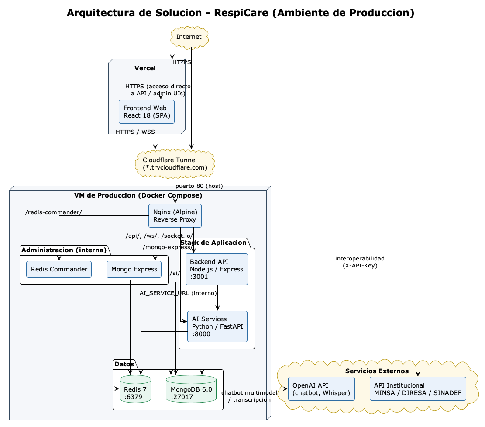

# Configuración de Ambientes y Procedimiento de Despliegue para el Proyecto de Construcción de Software II

**Asignatura:** Construcción de Software II
**Unidad de Competencia:** Integración, despliegue, pruebas y gestión de la configuración de soluciones de software
**Tipo de Actividad:** Trabajo de Investigación Aplicada y Documentación Técnica
**Modalidad:** Grupal (Equipo de Proyecto)

---

## TÍTULO DEL TRABAJO

Diseño y Elaboración del Documento de Configuración de Ambientes y Procedimiento de Despliegue para RespiCare — Sistema Web y Móvil para la Detección de Enfermedades Respiratorias en Tacna, utilizando prácticas de Integración Continua (CI), Entrega Continua (CD) y DevOps

| Campo | Valor |
|---|---|
| Proyecto | RespiCare — Sistema Web y Móvil para la Detección de Enfermedades Respiratorias en Tacna |
| Curso | Construcción de Software II |
| Docente | Ing. Ricardo Valcárcel Alvarado |
| Integrantes | Cesar Fabian Chávez Linares (2019063854) — Líder de equipo, desarrollo y despliegue · Piero Alexander Paja de la Cruz (2020067576) — Documentación |
| Versión del documento | 1.0.0 |
| Versión del sistema documentado | v2.1.5 (ver `CHANGELOG.md`) |
| Fecha | 24/10/2026 |

---

## CONTEXTUALIZACIÓN

En el curso de **Construcción de Software II**, el equipo retoma la solución de software desarrollada en Construcción de Software I —**RespiCare**, una plataforma clínica para la gestión, monitoreo y análisis de enfermedades respiratorias en Tacna— y la prepara formalmente para su despliegue en ambientes controlados y productivos.

El sistema ya opera en un ambiente de producción real desde el ciclo anterior: un stack Docker (MongoDB, Redis, backend Node.js, AI services en Python/FastAPI y Nginx) corriendo en una VM propia expuesta mediante Cloudflare Tunnel, con el frontend web desplegado de forma independiente en Vercel. Esto permite que el presente trabajo no sea un ejercicio teórico sobre una infraestructura hipotética, sino la documentación formal —con sus aciertos y sus vacíos honestamente señalados— de un flujo de despliegue que ya se ejecuta.

Este documento investiga los conceptos de gestión de ambientes y despliegue de software exigidos por la unidad de competencia, y los aplica directamente al proyecto desarrollado durante el curso, diseñando un **Documento de Configuración de Ambientes** y un **Procedimiento de Despliegue** propios de RespiCare.

---

## COMPETENCIA DEL CURSO

Implementa, integra y despliega soluciones de software aplicando estándares de calidad, automatización, gestión de configuración y buenas prácticas DevOps para garantizar su correcta operación en diversos ambientes tecnológicos.

---

## RESULTADO DE APRENDIZAJE

Al finalizar la actividad, el estudiante es capaz de:

- Configurar ambientes de desarrollo, pruebas y producción.
- Gestionar versiones mediante herramientas de control de código fuente.
- Diseñar procedimientos de despliegue seguros y repetibles.
- Aplicar principios de DevOps e Integración Continua.
- Elaborar documentación técnica asociada al despliegue de aplicaciones.
- Gestionar riesgos relacionados con la liberación de software.

---

## OBJETIVO GENERAL

Elaborar el Documento de Configuración de Ambientes y el Procedimiento de Despliegue aplicados a RespiCare, incorporando las prácticas de integración continua, calidad y gestión de configuración que el proyecto ya tiene implementadas, y señalando explícitamente las que aún están pendientes.

## OBJETIVOS ESPECÍFICOS

1. Investigar los conceptos relacionados con la gestión de ambientes y despliegue de software.
2. Analizar la arquitectura tecnológica de RespiCare (backend, AI services, web, móvil, datos).
3. Definir la configuración técnica real de los ambientes utilizados (desarrollo, integración/CI, y producción).
4. Diseñar un procedimiento formal de despliegue, alineado con los scripts y workflows ya existentes en el repositorio.
5. Implementar controles de calidad y seguridad durante la liberación de versiones.
6. Elaborar mecanismos de rollback y recuperación ante fallos.
7. Aplicar conceptos básicos de DevOps y automatización al flujo de trabajo del proyecto.

---

## CASO DE ESTUDIO

El equipo utiliza la solución de software desarrollada durante las sesiones de clase del curso: **RespiCare**, creada en Construcción de Software I y evolucionada en Construcción de Software II (Sprint 13: interoperabilidad institucional MINSA/DIRESA/SINADEF e integración de wearables como capa de validación clínica).

---

# DESARROLLO DEL TRABAJO

## PARTE I. INVESTIGACIÓN TEÓRICA

### Tema 1. Despliegue de Software

**Concepto.** El despliegue de software es el conjunto de actividades necesarias para hacer disponible una versión de una aplicación en un ambiente determinado, de modo que pueda ser utilizada por usuarios reales o por procesos de validación. Incluye la distribución de artefactos (código compilado, imágenes de contenedor, builds estáticos), la configuración del entorno de ejecución y la verificación de que el sistema quedó operativo.

**Importancia dentro del ciclo de vida del software.** El despliegue es la fase donde el valor construido durante el desarrollo se materializa para el usuario final. Un despliegue mal planificado puede introducir indisponibilidad, pérdida de datos o vulnerabilidades, incluso si el código en sí es correcto — por eso forma parte de la gestión de la configuración y no solo de la ingeniería de software pura.

**Estrategias de despliegue.**

| Estrategia | Descripción | ¿Aplica en RespiCare? |
|---|---|---|
| Recreate (directo) | Se detiene la versión anterior y se levanta la nueva; hay una ventana breve de indisponibilidad | **Sí** — es la estrategia real: `scripts/deploy-vm.sh` ejecuta `docker compose up -d --build`, que recrea los contenedores |
| Blue-Green | Dos ambientes idénticos (azul/verde); se conmuta el tráfico una vez validado el nuevo | No implementada — requeriría una segunda VM o balanceador, fuera del alcance actual |
| Canary | La nueva versión recibe un porcentaje pequeño de tráfico antes de generalizarse | No implementada — el proyecto tiene un solo nodo de producción |
| Rolling | Actualización gradual de instancias en un clúster | No aplica — no hay orquestador tipo Kubernetes en producción (se evaluó y se descartó; ver Tema 5) |

**Beneficios y riesgos.** Un despliegue automatizado y repetible reduce el error humano, acelera la entrega de valor y facilita la reversión. Los riesgos principales son la pérdida de disponibilidad, la corrupción o pérdida de datos clínicos, la exposición de secretos y la introducción de regresiones no detectadas por las pruebas.

**Despliegue manual y automatizado.** RespiCare tiene un modelo **híbrido**: la validación (pruebas unitarias, integración, E2E, seguridad y rendimiento) está completamente automatizada en GitHub Actions (`ci-cd-complete.yml` y workflows dedicados), y el frontend web se autodespliega en Vercel al hacer push. Sin embargo, la ejecución del despliegue de backend/AI services en la VM de producción sigue siendo **manual**, disparada por el responsable mediante `./scripts/deploy-vm.sh --build`, con scripts de apoyo (`backup-vm.sh`, `smoke-test-vm.sh`) que automatizan los pasos de respaldo y verificación pero no el disparo en sí.

---

### Tema 2. Ambientes de Software

**Ambiente de Desarrollo (DEV)**
- Definición: ambiente local donde se codifica y se prueban cambios antes de integrarlos.
- Objetivo: ciclo de retroalimentación rápido, sin riesgo sobre datos reales.
- Herramientas: Docker Compose (`docker-compose.dev.yml`), VS Code, hot-reload de React/Next.js.
- Configuración recomendada: datos ficticios, secretos de ejemplo, servicios de administración (Mongo Express, Redis Commander) habilitados.

**Ambiente de Integración (INT)**
- Propósito: validar que los componentes recién integrados (commits/PRs) compilan y pasan pruebas en un entorno limpio y reproducible.
- Validación de integración: GitHub Actions levanta un contenedor `mongo:7.0` efímero por job y corre `backend-integration-tests`, `backend-e2e-tests`.
- Gestión de versiones: cada push/PR a `main`/`develop` dispara el pipeline (`ci-cd-complete.yml`); Dependabot abre PRs automáticos para dependencias.

**Ambiente de Calidad (QA)**
- Pruebas funcionales, de integración y de aceptación: suites descritas en `Documentation/CATALOGO_PRUEBAS.md`, ejecutadas vía `testing.yml`, `backend-tests.yml`, `web-tests.yml`, `ai-services-tests.yml`, `mobile-ci.yml`.
- No existe hoy un ambiente de QA desplegado y persistente (con URL propia) — la validación de QA ocurre **dentro de CI**, no en un servidor dedicado. Es un gap reconocido también en `Documentation/CHECKLIST_DESPLIEGUE_TESTABILIDAD_QA.md`.

**Ambiente de Preproducción (STAGING)**
- Simulación de producción / pruebas finales antes de liberar.
- **Estado real: no existe un ambiente de staging dedicado para backend/AI services.** Hubo un workflow `deploy-staging.yml` que asumía un clúster Kubernetes de staging (namespace `respicare-staging`); nunca se ejecutó ni tuvo el secret `KUBECONFIG_STAGING` configurado, y se archivó en `docs/archive/workflows/` para no contradecir el flujo real.
- Lo más cercano a un staging que sí existe: los **Preview Deployments de Vercel** por cada Pull Request del frontend web, que sirven una build real contra el backend de producción antes del merge.

**Ambiente de Producción (PROD)**
- Operación real: stack `docker-compose.vm.yml` (MongoDB, Redis, backend, AI services, Nginx, Mongo Express, Redis Commander) en una VM propia, expuesto mediante Cloudflare Tunnel; frontend web en Vercel (rama `fabian`).
- Seguridad: JWT dual, cifrado de campos AES-256-GCM, CORS restringido, rate limiting, Helmet.js, puertos de base de datos únicamente en `127.0.0.1`.
- Monitoreo: healthchecks de Docker Compose por servicio, logs `json-file` con rotación, dashboard de estado en el propio frontend.

---

### Tema 3. Gestión de Configuración

**Gestión de versiones.** El código fuente se versiona en Git/GitHub. La rama de trabajo principal es `fabian` (donde ocurre el desarrollo activo y el despliegue real), con `main` como rama de referencia formal; Dependabot gestiona decenas de ramas de actualización de dependencias de forma automática.

**Control de cambios.** Los cambios entran por *pull request* con el pipeline de CI (`ci-cd-complete.yml`) como gate de validación (`all-tests-passed`). Dependabot y los workflows de seguridad (`sast-scan.yml`, `dast-scan.yml`, `security-scan.yml`, `scorecard.yml`) actúan como controles adicionales de calidad y riesgo sobre cada cambio.

**Baselines.** `release-please` mantiene un manifiesto de versión (`.release-please-manifest.json`) y genera `CHANGELOG.md` automáticamente a partir de *commits* convencionales, estableciendo líneas base (baselines) formales de versión del producto. Las imágenes Docker de `backend` y `ai-services` se construyen en la propia VM, por lo que la "línea base" desplegada en producción es, en la práctica, el *commit* exacto registrado en `.rollback_target` tras cada despliegue (ver `Documentation/PLAN_DE_DESPLIEGUE.md`).

**Trazabilidad.** Cada cambio queda trazado por el historial de Git con mensajes en formato *Conventional Commits* (`feat(scope): ...`, `fix(scope): ...`, `chore(ci): ...`, `docs(...): ...`), visibles en `git log`. A nivel de aplicación, la colección `auditlogs` de MongoDB registra acciones de usuarios sobre datos clínicos, complementando la trazabilidad de infraestructura con trazabilidad funcional.

**Gestión de artefactos.** No existe un registro de contenedores externo (tipo `ghcr.io` o Docker Hub privado) en el flujo real: las imágenes de `backend` y `ai-services` se construyen directamente en la VM de destino mediante `docker compose build`. El frontend web no genera un artefacto Docker en producción — Vercel construye y sirve el build de React directamente desde el repositorio en cada push.

---

### Tema 4. DevOps e Integración Continua

**DevOps.** En RespiCare, DevOps no es un equipo separado sino un conjunto de prácticas que el mismo responsable del desarrollo aplica sobre su propio código: automatización de pruebas, scripts de despliegue/respaldo/verificación, y monitoreo post-despliegue. Esto está documentado explícitamente en `Documentation/PLAN_DE_DESPLIEGUE.md`, sección 5 ("Roles y responsabilidades"), donde se reconoce honestamente que todos los roles recaen en la misma persona.

**Continuous Integration (CI).** Cada push o PR a `main`/`develop` ejecuta `ci-cd-complete.yml`, que corre en paralelo: pruebas unitarias, de integración y E2E del backend contra una instancia MongoDB efímera, pruebas de seguridad (`npm run test:security`, `npm audit`), pruebas de rendimiento, pruebas del frontend web, escaneo de vulnerabilidades (Trivy) y verificación de compilación TypeScript. El job final `all-tests-passed` consolida el resultado de todos los anteriores como condición de salida.

**Continuous Delivery (CD).** El frontend web tiene **entrega continua real**: cada push a `fabian` dispara un autodeploy en Vercel sin intervención manual adicional. El backend y los AI services, en cambio, están en un punto intermedio: el *build* y las pruebas son continuos (CI), pero la *liberación* a producción (`./scripts/deploy-vm.sh --build` en la VM) sigue requiriendo activación manual del responsable — es decir, **Continuous Delivery, no Continuous Deployment**, para esos dos componentes.

**Continuous Deployment.** Se diferencia de *Continuous Delivery* en que no requiere aprobación humana para pasar a producción. RespiCare solo alcanza este nivel para el componente web (vía Vercel); backend/AI services permanecen en modo manual por decisión deliberada, dado que gestionan datos clínicos y requieren verificación antes de exponer cambios.

**Pipeline de despliegue.** El flujo real combina ambos niveles: validación 100% automatizada en CI → liberación automática del frontend (Vercel) → liberación manual, pero scriptada y verificable, del backend/AI services/datos (VM). El detalle se documenta en el Anexo D de este documento.

**Automatización.** Los scripts en `scripts/` cubren las tareas operativas repetitivas: `deploy-vm.sh` (despliegue), `backup-vm.sh` (respaldo pre-despliegue de MongoDB/Redis/`.env`), `smoke-test-vm.sh` (pruebas de humo post-despliegue), `tunnel-manager.sh` (gestión del túnel Cloudflare, incluida la reescritura automática de URLs cuando el túnel efímero rota) y `validate-env.sh` (validación de variables de entorno).

---

### Tema 5. Herramientas Modernas de Despliegue

| Herramienta | Funcionalidad | ¿Se usa en RespiCare? |
|---|---|---|
| **Git** | Control de versiones distribuido | ✅ Sí — control de versiones de todo el monorepo |
| **GitHub** | Alojamiento de repositorio, Pull Requests, Issues | ✅ Sí — repositorio principal, PRs, Dependabot |
| **GitLab** | Alternativa integrada a GitHub con CI/CD propio | ❌ No se usa |
| **Azure DevOps** | Suite de CI/CD, boards y repos de Microsoft | ❌ No se usa |
| **Jenkins** | Servidor de automatización CI/CD autoalojado | ❌ No se usa — el rol de Jenkins lo cubre **GitHub Actions** (19 workflows activos en `.github/workflows/`) |
| **Docker** | Empaquetado y ejecución de contenedores | ✅ Sí — base de toda la infraestructura (`docker-compose.vm.yml`, `.dev.yml`, Dockerfiles de backend/AI/web) |
| **Kubernetes** | Orquestación de contenedores a escala | ❌ No se usa en producción — se evaluó (`deploy-production.yml`, namespace `respicare-production`) pero **nunca se ejecutó** (0 corridas, sin secret `KUBECONFIG_PRODUCTION`); se archivó en `docs/archive/workflows/` por no reflejar la infraestructura real |
| **SonarQube** | Análisis estático de calidad de código | ❌ No se usa SonarQube específicamente — el rol de análisis estático lo cubren `static-code-analysis.yml`, ESLint y `sast-scan.yml` |
| **Postman** | Pruebas manuales/colecciones de API REST | ✅ Sí — documentado como herramienta de prueba de los endpoints REST junto con Swagger UI (`/api/docs`, `/ai/docs`) |

---

## PARTE II. DOCUMENTO DE CONFIGURACIÓN DE AMBIENTES

### 1. Información General

| Campo | Descripción |
|---|---|
| Proyecto | RespiCare — Sistema Web y Móvil para la Detección de Enfermedades Respiratorias en Tacna |
| Curso | Construcción de Software II |
| Versión | 1.0.0 (documento) / v2.1.5 (sistema) |
| Fecha | 24/10/2026 |
| Integrantes | Cesar Fabian Chávez Linares (2019063854) — líder de equipo, desarrollo y despliegue · Piero Alexander Paja de la Cruz (2020067576) — documentación |
| Docente | Ing. Ricardo Valcárcel Alvarado |

---

### 2. Descripción del Proyecto

**Problema a resolver.** En Tacna no existe una plataforma integrada que permita a pacientes y personal de salud reportar síntomas respiratorios, recibir un análisis clínico asistido por IA, hacer seguimiento de citas/historiales/alertas y compartir información epidemiológica agregada con autoridades sanitarias (MINSA/DIRESA/SINADEF) de forma estandarizada.

**Objetivo del sistema.** Brindar una plataforma clínica integral —web, móvil y servicios de IA— para la gestión, monitoreo y análisis de enfermedades respiratorias, que apoye tanto al paciente (reporte de síntomas, chatbot, wearables) como al personal médico (dashboard, alertas, analítica epidemiológica) y a las autoridades sanitarias (interoperabilidad institucional).

**Alcance.** Backend REST (Node.js/Express/TypeScript), servicios de IA/ML (Python/FastAPI: análisis de síntomas, imágenes médicas, audio/tos, chatbot multimodal), dashboard web (React 18), aplicación móvil Android (Next.js + Capacitor, con BLE para wearables, offline-first y biometría), y una capa de interoperabilidad institucional (HL7 FHIR, API MINSA/DIRESA/SINADEF).

**Usuarios involucrados.** Pacientes, doctores, administradores del sistema (roles `patient`, `doctor`, `admin`), y —a nivel de integración— sistemas externos de autoridades sanitarias regionales autenticados por API Key.

**Tecnologías utilizadas.**

| Capa | Tecnología | Versión |
|---|---|---|
| Frontend Web | React, Axios, Recharts | 18.x |
| App Móvil | Next.js, Capacitor | 16.x / 6.x |
| Backend | Node.js, Express, TypeScript | 18+ / 4.x |
| AI Services | Python, FastAPI, uvicorn | 3.11+ |
| ML | PyTorch, Whisper, ResNet50, scikit-learn | — |
| Base de Datos | MongoDB | 6.0 |
| Caché | Redis | 7.x |
| Reverse Proxy | Nginx Alpine | 1.31 |
| Túnel | Cloudflare Tunnel (`cloudflared`) | 2026.x |
| Contenedores | Docker, Docker Compose | — |
| CI/CD | GitHub Actions + Vercel | — |
| Cifrado | AES-256-GCM (campos sensibles) | — |

---

### 3. Arquitectura de la Solución

**Diagrama de arquitectura (producción real):**



*Diagrama de despliegue generado con PlantUML (fuente: `Documentation/Diagramas/arquitectura-respicare-produccion.puml`), construido a partir de `docker-compose.vm.yml` y `README.md`.*

**Componentes del sistema.** `backend/` (API REST + WebSockets), `ai-services/` (motor de IA/ML, 216 archivos Python), `web/` (dashboard React), `mobile/medical-app/` (app Capacitor/Next.js), `nginx/` (reverse proxy + CORS unificado), `mongodb`/`redis` (persistencia y caché).

**Integraciones externas.**
- **OpenAI** — chatbot multimodal (texto + imagen + audio) y transcripción con Whisper.
- **API Institucional MINSA/DIRESA/SINADEF** — exportación epidemiológica agregada, sincronización de catálogo de centros de salud, recepción de alertas sanitarias; autenticada por `X-API-Key` con scopes, rate limiting y auditoría dedicados (`backend/openapi/institutional-api.yaml`).
- **Cloudflare Tunnel** — expone el stack de la VM a Internet sin necesidad de IP pública fija ni dominio de pago.
- **Vercel** — hosting y CI/CD del frontend web (build + deploy automático por push).

**Servicios utilizados.** Mongo Express y Redis Commander como herramientas de administración de datos accesibles vía el mismo túnel (protegidas con autenticación básica), Swagger UI (`/api/docs`) y ReDoc/Swagger de AI services (`/ai/docs`) para documentación interactiva de las APIs.

---

### 4. Configuración de Ambientes

**Ambiente DEV**

| Recurso | Configuración |
|---|---|
| Orquestación | `docker-compose.dev.yml` |
| Sistema Operativo | Windows / Linux / macOS (vía Docker Desktop) |
| IDE | VS Code |
| Framework | React (web), Next.js (mobile), Express (backend), FastAPI (AI) |
| Base de Datos | MongoDB 6.0 local (puerto expuesto, sin TLS) |
| Caché | Redis sin contraseña |
| Contenedores | Docker Compose, hot-reload activo |
| Admin UI | Mongo Express, Redis Commander habilitados |

**Ambiente de Pruebas (CI — reemplaza al "QA" tradicional con servidor propio)**

| Recurso | Configuración |
|---|---|
| Orquestador | GitHub Actions (`ci-cd-complete.yml`, `backend-tests.yml`, `web-tests.yml`, `ai-services-tests.yml`, `mobile-ci.yml`) |
| Base de datos | `mongo:7.0` efímero por job, descartado al finalizar |
| Herramientas | Jest (backend/web), Pytest (AI), Cypress (E2E web), `npm audit`, Trivy |
| Automatización | 100% — se ejecuta en cada push/PR sin intervención manual |
| Persistencia | Ninguna — no es un servidor con URL propia, es un ambiente efímero por ejecución |

**Ambiente STAGING**

| Recurso | Configuración |
|---|---|
| Infraestructura | **No existe un staging dedicado para backend/AI services** (gap reconocido; `deploy-staging.yml` para Kubernetes nunca se ejecutó y fue archivado) |
| Lo más cercano | Vercel Preview Deployments del frontend web por cada PR, contra el backend de producción |
| SSL | Habilitado automáticamente por Vercel en cada preview |
| Monitoreo | El propio dashboard de Vercel (build logs, deployment status) |

**Ambiente PROD**

| Recurso | Configuración |
|---|---|
| Hosting (backend/AI/datos) | VM propia — `docker-compose.vm.yml` vía `scripts/deploy-vm.sh` |
| Hosting (web) | Vercel (autodeploy desde rama `fabian`) |
| Exposición pública | Cloudflare Tunnel (`cloudflared`, proceso a nivel de host, gestionado por `scripts/tunnel-manager.sh`) |
| Escalabilidad | Límites de CPU/memoria por servicio en `docker-compose.vm.yml` (p. ej. `ai-services`: 2 CPU / 3 GB límite) |
| Backups | `scripts/backup-vm.sh` — mongodump + snapshot RDB de Redis + copia de `.env`/`.env.vm`, retención 14 días |
| Seguridad | Hardening aplicado: puertos de MongoDB/Redis solo en `127.0.0.1`, CORS restringido, Helmet.js, cifrado AES-256-GCM de campos sensibles |

---

### 5. Gestión de Versiones

**Modelo de ramas.** RespiCare no sigue un *Gitflow* estricto de múltiples ramas de larga vida. El flujo real es:

```
main                      ← rama de referencia formal (release-please)
  └── fabian               ← rama de desarrollo y despliegue activo
       ├── dependabot/*    ← decenas de ramas automáticas de actualización de dependencias
       └── (feature work directamente en fabian o vía PR)
```

> **Nota de transparencia:** `scripts/tunnel-manager.sh` realiza *commit + push automático* a `fabian` cuando la URL del túnel Cloudflare rota (reescribe `.env`, `nginx.vm.conf`, configs de mobile y `web/src/utils/apiBase.js`). Es una automatización sin revisión humana que debe tenerse presente al auditar el historial de commits de esta rama.

**Convenciones de commits.** Se usa el estándar **Conventional Commits** (`tipo(ámbito): descripción`), verificable en `git log`:

```
fix(backend): limitar maxWorkers de Jest para evitar crashes por OOM
chore(ci): archivar deploy-staging.yml y actualizar checklist de QA
docs(despliegue): documentar umbrales de rendimiento (SLA) en el plan
feat(scripts): agregar scripts de respaldo y smoke test pre/post despliegue
```

Tipos usados: `feat`, `fix`, `chore`, `docs`, `refactor`, con ámbito entre paréntesis (`backend`, `web`, `ai-services`, `ci`, `despliegue`, `scripts`).

**Versionado semántico.** Gestionado por `release-please` (`release-please.yml`, `release-please-config.json`), que genera automáticamente `CHANGELOG.md` y PRs de release a partir de los *commits* convencionales. El manifiesto (`.release-please-manifest.json`) registra la versión del paquete raíz; la versión funcional del producto documentada en `README.md`/`CHANGELOG.md` es **v2.1.5**.

**Flujo de aprobación.** Cambios de código pasan por Pull Request con el gate `all-tests-passed` de `ci-cd-complete.yml` como condición de aprobación automática; los PRs de Dependabot siguen el mismo gate. No existe hoy una aprobación humana adicional obligatoria antes de mergear (el equipo es de un responsable técnico principal), lo cual se documenta como una característica del contexto académico, no como ausencia de control.

---

### 6. Seguridad de Ambientes

**Controles mínimos**

| Control | Estado en RespiCare |
|---|---|
| MFA | ❌ No implementado — gap identificado; autenticación es JWT + contraseña (bcrypt) únicamente |
| Gestión de accesos | ✅ JWT dual (access 7d + refresh 30d con rotación) + RBAC por rol (`admin`, `doctor`, `patient`) |
| Firewall | ✅ Puertos de MongoDB/Redis bindeados a `127.0.0.1` en la VM de producción; solo 80/443 expuestos vía túnel |
| Roles y permisos | ✅ Middleware de autorización por rol en el backend |
| Cifrado TLS | ✅ HTTPS automático vía Cloudflare Tunnel y Vercel (certificados gestionados por esas plataformas, no manualmente) |
| Respaldo de información | ✅ `scripts/backup-vm.sh` — mongodump + RDB Redis + copia de configuración, retención 14 días |
| Gestión de vulnerabilidades | ✅ Trivy (`ci-cd-complete.yml`), `sast-scan.yml`, `dast-scan.yml`, `security-scan.yml`, `security-zap.yml`, Dependabot, OpenSSF Scorecard (`scorecard.yml`), y Gitleaks + TruffleHog como *pre-commit hooks* locales contra fuga de secretos |

Controles adicionales ya presentes: cifrado de campos sensibles con AES-256-GCM (MongoDB), sanitización contra inyección (`mongo-sanitize`, `xss-clean`, `hpp`), cabeceras de seguridad con Helmet.js, y auditoría completa de acciones en la colección `auditlogs`.

---

## PARTE III. PROCEDIMIENTO DE DESPLIEGUE

### Objetivo

Establecer los pasos necesarios para desplegar RespiCare (backend, AI services y datos en la VM de producción; frontend web en Vercel) de forma segura y controlada, minimizando interrupciones y riesgo sobre datos clínicos.

### Alcance

Aplica a:

- **DEV** — `docker-compose.dev.yml`, local.
- **CI (reemplaza QA/STAGING formales)** — GitHub Actions, efímero.
- **PROD** — `docker-compose.vm.yml` + Cloudflare Tunnel (backend/AI/datos) y Vercel (web).

> No se incluye un ambiente STAGING dedicado porque, como se documenta en la Parte II, no existe en la infraestructura real del proyecto.

### Roles y Responsabilidades

| Rol | Responsabilidad | Quién lo cubre en RespiCare |
|---|---|---|
| Scrum Master / Líder | Autoriza despliegues, coordina y decide escalamiento | Cesar Fabian Chávez Linares |
| Desarrollador | Prepara la versión, resuelve observaciones de CI | Cesar Fabian Chávez Linares |
| Tester / QA | Valida calidad mediante las suites automatizadas | Cesar Fabian Chávez Linares (apoyado en `CATALOGO_PRUEBAS.md` y CI) |
| DevOps | Ejecuta el despliegue (`deploy-vm.sh`) y gestiona el túnel | Cesar Fabian Chávez Linares |
| DBA | Gestiona respaldo/restauración de MongoDB y Redis | Cesar Fabian Chávez Linares (`backup-vm.sh`) |
| Cliente / Propietario del servicio | Aceptación final, autoriza la ventana de cambio | Docente del curso, según corresponda a la entrega académica |

### Procedimiento General

**Fase 1: Preparación**
- Consolidar cambios en `fabian` con CI en verde (`ci-cd-complete.yml`, `backend-tests.yml`, `web-tests.yml`, `ai-services-tests.yml`, `mobile-ci.yml`).
- Confirmar versión candidata (commit) y, si corresponde, PR de `release-please` mergeado.
- Actualizar documentación relevante (este documento, `CHANGELOG.md`, `PLAN_DE_DESPLIEGUE.md`).

**Fase 2: Pruebas**
- Ejecutar pruebas unitarias e integración ya corridas en CI (verificar estado verde antes de desplegar).
- Ejecutar pruebas funcionales/E2E (`Documentation/CATALOGO_PRUEBAS.md`).
- Resolver observaciones bloqueantes (ver `PENDIENTES_CORRECCION_TESTS.md` para fails ya conocidos y no bloqueantes del flujo de despliegue).

**Fase 3: Aprobación**
- Revisión técnica del diff y del resultado de `all-tests-passed`.
- Evaluación de riesgos (sección 10 de `PLAN_DE_DESPLIEGUE.md`): compatibilidad de configuración, migraciones de esquema, indisponibilidad.
- Aprobación formal del responsable (Cesar Fabian Chávez Linares), registrada en la Matriz de Aprobación de `PLAN_DE_DESPLIEGUE.md`.

**Fase 4: Despliegue**
- Respaldo previo: `./scripts/backup-vm.sh` (genera `backups/<timestamp>/{mongodb.archive.gz, redis.rdb, .env, .env.vm}`).
- Publicación de artefactos: `./scripts/deploy-vm.sh --build` reconstruye y levanta `mongodb`, `redis`, `backend`, `ai-services`, `nginx` en la VM (imágenes construidas localmente, sin registro externo).
- Push a `fabian`/`main` dispara en paralelo el autodeploy del frontend web en Vercel.
- Configuración de servicios: variables de entorno validadas automáticamente por `deploy-vm.sh` (`MONGO_PASSWORD`, `REDIS_PASSWORD`, `JWT_SECRET`, `JWT_REFRESH_SECRET`); migración de datos solo si hay cambios de esquema, con respaldo previo obligatorio.

**Fase 5: Validación**
- Smoke test: `./scripts/smoke-test-vm.sh` — valida contenedores `healthy`, endpoints (`/health`, `/ai/api/v1/health`, `/ai/openapi.json`) vía Nginx, y un flujo mínimo de `auth/login`.
- Verificación funcional: confirmar que el build de Vercel quedó en estado "Ready" y que la URL del túnel Cloudflare responde.
- Revisión de logs: `docker compose -f docker-compose.vm.yml logs --tail=100` en los primeros minutos tras el despliegue.

**Fase 6: Cierre**
- Actualización documental: registrar el commit desplegado y, si hubo cambios web, el deployment ID de Vercel.
- Registro de evidencias: resultados de smoke test, capturas de healthchecks, en `PLAN_DE_DESPLIEGUE.md` o la bitácora del sprint vigente.
- Lecciones aprendidas: documentar desviaciones o incidentes en `PENDIENTES_CORRECCION_TESTS.md` o en este documento.

---

## PARTE IV. ANEXOS OBLIGATORIOS

### Anexo A. Matriz RACI

| Actividad | Desarrollador | QA | DevOps | Líder |
|---|---|---|---|---|
| Configuración de ambientes | R | C | A | I |
| Pruebas | C | R | I | A |
| Despliegue | C | I | R | A |
| Validación | C | R | I | A |

*(R = Responsable, A = Aprueba, C = Consultado, I = Informado. En RespiCare todos los roles recaen sobre Cesar Fabian Chávez Linares; la matriz se mantiene explícita para dejar claro qué responsabilidad corresponde a cada función, independientemente de quién la ejecute.)*

### Anexo B. Checklist de Despliegue

**Pre-Despliegue**

- [ ] Código aprobado (CI en verde, `all-tests-passed` exitoso)
- [ ] Pruebas completadas (unitarias, integración, E2E, seguridad, rendimiento)
- [ ] Backups realizados (`./scripts/backup-vm.sh` ejecutado y verificado)
- [ ] Documentación actualizada (este documento, `CHANGELOG.md`, `PLAN_DE_DESPLIEGUE.md`)
- [ ] Riesgos identificados (sección 10 de `PLAN_DE_DESPLIEGUE.md` revisada)
- [ ] Variables de entorno de producción validadas (sin placeholders — `MONGO_PASSWORD`, `REDIS_PASSWORD`, `JWT_SECRET`, `JWT_REFRESH_SECRET`, `FIELD_ENCRYPTION_KEY`, `CORS_ORIGINS`)
- [ ] `tunnel-manager.sh`/`cloudflared` activo y URL pública accesible

**Post-Despliegue**

- [ ] Aplicación disponible (healthchecks de `mongodb`, `redis`, `backend`, `ai-services`, `nginx` en `healthy`)
- [ ] Servicios operativos (`./scripts/smoke-test-vm.sh` sin fallos)
- [ ] Base de datos validada (conteo de colecciones y, si hubo migración, conciliación antes/después)
- [ ] Build de Vercel (web) en estado "Ready"
- [ ] Usuario/responsable conforme (aceptación final registrada)

### Anexo C. Plan de Rollback

**Escenarios de falla**
- Un healthcheck de Compose no llega a `healthy` tras varios reintentos.
- Error crítico en endpoints principales (`/health`, `/api/v1/auth/login`, `/ai/api/v1/health`) tras el despliegue.
- Pérdida de integridad de datos detectada post-migración.
- Degradación evidente del servicio tras habilitar el túnel público.

**Responsables**
- Declaración de "no-go"/rollback y ejecución: Cesar Fabian Chávez Linares (único responsable técnico del proyecto).

**Procedimiento de reversión**
1. Declarar rollback y registrar la hora.
2. Detener el tráfico público: detener `tunnel-manager.sh`/`cloudflared` en la VM (el túnel corre a nivel de host, no como contenedor).
3. Restaurar el código al commit estable anterior (`.rollback_target`) en la VM: `git checkout <commit-estable>`.
4. Reconstruir y levantar con la versión anterior: `./scripts/deploy-vm.sh --build` (las imágenes se buildean localmente, no hay tag previo en un registro externo que recuperar).
5. Si el autodeploy de `tunnel-manager.sh` alcanzó a disparar un deploy en Vercel con configuración de la versión fallida, revertirlo desde el dashboard de Vercel o con un commit que restaure `web/src/utils/apiBase.js`.
6. Si hubo cambios de esquema en MongoDB, evaluar impacto **antes** de restaurar el volumen desde el backup de `backup-vm.sh` — no restaurar sin verificar pérdida de transacciones posteriores al respaldo.
7. Reiniciar `tunnel-manager.sh` para re-exponer el servicio.

**Tiempo objetivo de recuperación**
- < 10 minutos para rollback de código/contenedores (sin restauración de base de datos).
- Variable, dependiente del tamaño del respaldo, si se requiere `mongorestore`.

**Validación posterior**
- Reejecutar `./scripts/smoke-test-vm.sh` contra la versión restaurada.
- Confirmar healthchecks `healthy` y accesibilidad de la URL pública.
- Documentar el incidente en `Documentation/PLAN_DE_DESPLIEGUE.md` o `PENDIENTES_CORRECCION_TESTS.md`.

### Anexo D. Pipeline CI/CD

Flujo real de RespiCare (no es un pipeline único de extremo a extremo, sino dos ramales que convergen en producción):

```
Git Commit / Push a `fabian`
        │
        ▼
Build + Pruebas Automáticas (GitHub Actions — ci-cd-complete.yml)
  ├─ Unit / Integration / E2E / Security / Performance (backend)
  ├─ Lint + Unit (web)
  └─ TypeScript build + Trivy scan
        │
        ▼
Análisis de Calidad y Seguridad adicional
  (static-code-analysis.yml, sast-scan.yml, dast-scan.yml,
   security-scan.yml, security-zap.yml, scorecard.yml)
        │
        ├──────────────────────────────┐
        ▼                              ▼
  Deploy Web (automático)        Deploy Backend/AI/Datos (manual, scriptado)
  Vercel autodeploy                1. ./scripts/backup-vm.sh
  (rama `fabian` → build → Ready)  2. ./scripts/deploy-vm.sh --build
        │                          3. ./scripts/smoke-test-vm.sh
        ▼                              │
     PROD (Vercel)                     ▼
                                    PROD (VM + Cloudflare Tunnel)
```

> No existen etapas intermedias "Deploy QA" / "Deploy STAGING" en el pipeline real — la validación de calidad ocurre dentro de CI (ambientes efímeros), y la siguiente etapa después de aprobar el cambio es directamente producción. Este diseño está documentado como una decisión consciente dada la escala académica del proyecto, no como un paso omitido por descuido; el gap de staging queda registrado como mejora futura en `Documentation/CHECKLIST_DESPLIEGUE_TESTABILIDAD_QA.md`.

---

## Referencias del propio repositorio

Este documento se apoya y es consistente con los siguientes artefactos ya existentes en el proyecto:

- `Documentation/PLAN_DE_DESPLIEGUE.md` — plan de despliegue detallado con SLA de rendimiento, cronograma y matriz de aprobación.
- `Documentation/CHECKLIST_DESPLIEGUE_TESTABILIDAD_QA.md` — inventario de gaps de testabilidad y QA.
- `Documentation/CATALOGO_PRUEBAS.md` — catálogo de casos de prueba automatizados.
- `README.md` — arquitectura, stack tecnológico y estado de despliegue vigente.
- `scripts/deploy-vm.sh`, `scripts/backup-vm.sh`, `scripts/smoke-test-vm.sh`, `scripts/tunnel-manager.sh` — automatización operativa real.
- `.github/workflows/ci-cd-complete.yml` y workflows de seguridad — pipeline de CI real.

---

*Documento elaborado para RespiCare — Construcción de Software II — Universidad Privada de Tacna — 2026*
*Versión: 1.0.0 | Docente: Ing. Ricardo Valcárcel Alvarado*
